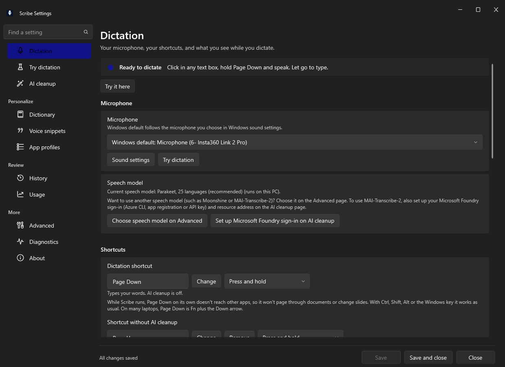
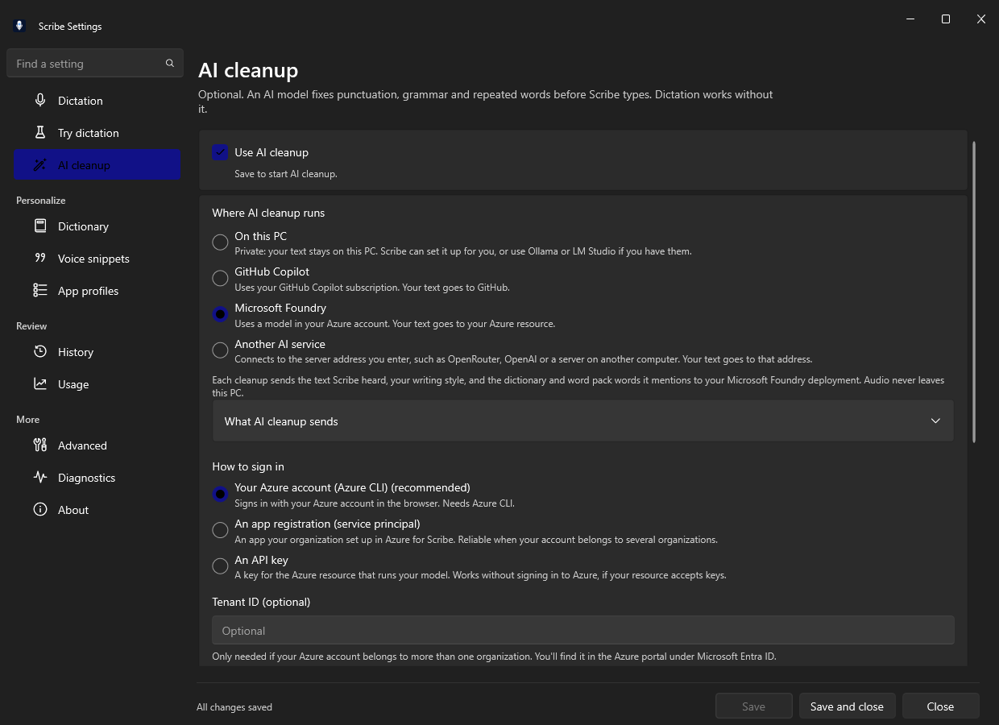
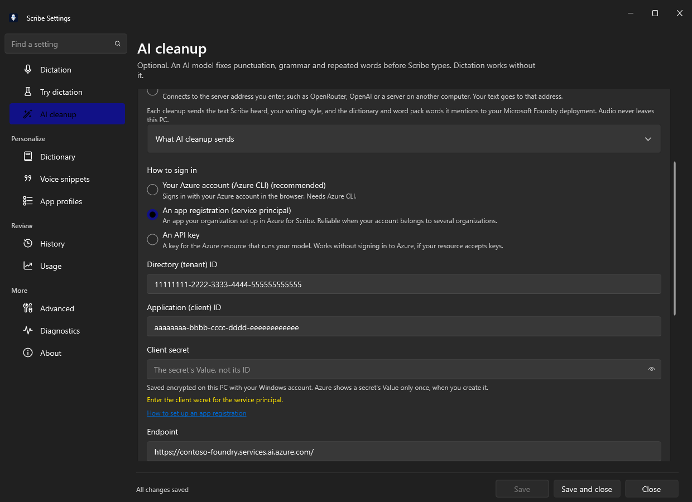
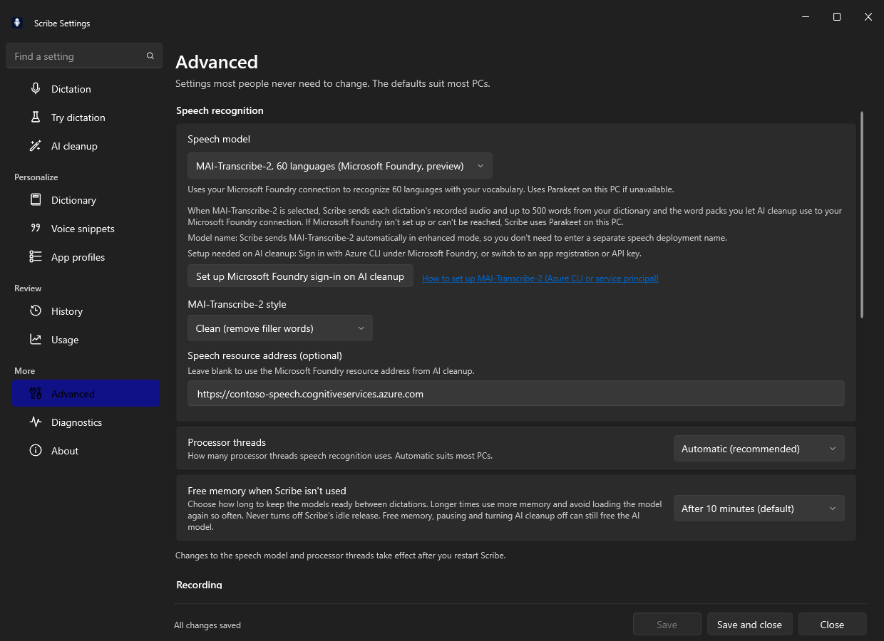

# Set up MAI-Transcribe-2 for speech recognition

Scribe includes NVIDIA Parakeet for offline speech recognition on your PC across 25 European
languages. In direct installs (`Scribe-win-x64-Setup.exe` and `Scribe-win-arm64-Setup.exe`, or when
`SCRIBE_PERF_FLAGS=MaiTranscribeSpeech` is enabled), you can also choose **MAI-Transcribe-2** from
Microsoft AI for cloud speech recognition across 60 languages, with built-in vocabulary biasing from
your dictionary and AI-permitted word packs, and automatic fallback to Parakeet on your PC whenever
you are offline.

> **Why are authentication and model selection on two pages?**
> Scribe shares one Microsoft Foundry sign-in (Azure CLI, app registration / service principal, or
> API key) across AI cleanup and MAI-Transcribe-2 so you never have to maintain two separate sets of
> Azure credentials. You configure your Microsoft Foundry sign-in on **Settings > AI cleanup**, and
> select **MAI-Transcribe-2** under **Settings > Advanced > Speech recognition** (or jump to both
> directly from the **Speech model** card on **Settings > Dictation**).

---

## What you will need

- A **Microsoft Foundry** (`AIServices`, `https://<your-resource>.services.ai.azure.com`) or **Azure
  Speech** (`https://<your-resource>.cognitiveservices.azure.com`) resource in a region that
  supports `MAI-Transcribe-2`.
- **No separate speech model deployment name is needed.** Unlike chat models, `MAI-Transcribe-2` is
  called through the Speech `transcriptions:transcribe` API (`api-version=2025-10-15`) by passing
  `"model": "MAI-Transcribe-2"` in `enhancedMode`. Scribe sends that model name automatically.
- One of three ways to authenticate to your Azure resource:
  1. **Your Azure account (Azure CLI)** (easiest for individual accounts).
  2. **An app registration (service principal)** (best when your account belongs to multiple
     organizations/tenants or your organization restricts interactive CLI tokens).
  3. **An API key** from your Microsoft Foundry or Azure Speech resource.

---

## Step 1: Start from Settings > Dictation

Open **Scribe Settings** from the tray icon. On the **Dictation** page, scroll to the **Speech
model** card right below **Microphone**:

The **Speech model** card shows which speech model is currently active and gives you two direct
shortcuts:

1. **Set up Microsoft Foundry sign-in on AI cleanup**: opens the **AI cleanup** page with
   **Microsoft Foundry** selected so you can configure your sign-in and resource address.
2. **Choose speech model on Advanced**: jumps straight to the **Speech model** picker on the
   **Advanced** page.

---

## Step 2: Configure your Microsoft Foundry authentication on AI cleanup

Choose **Set up Microsoft Foundry sign-in on AI cleanup** (or select **AI cleanup** in the left
navigation rail and pick **Microsoft Foundry**).

> **Note:** You do not have to keep **Use AI cleanup** turned on after saving if you only want to
> use `MAI-Transcribe-2` for speech recognition. `MAI-Transcribe-2` reuses the saved Microsoft
> Foundry sign-in and resource address even when AI cleanup itself is turned off.

Pick the sign-in method that matches how you access Azure:

### Option A: Your Azure account (Azure CLI) (recommended)

Best when you sign in to Azure with your own work or personal account on this PC:

1. Under **How to sign in**, select **Your Azure account (Azure CLI) (recommended)**.
2. If Azure CLI is not installed yet, click **Install Azure CLI** on the status row, then click
   **Sign in to Azure** to complete browser sign-in.
3. If your account belongs to more than one Microsoft Entra tenant, enter your target **Tenant ID
   (optional)** (the GUID from **Microsoft Entra ID > Overview** in the Azure portal) so Scribe
   authenticates against the right organization.
4. Pick your **Subscription** and **Model** (which fills in your Microsoft Foundry **Endpoint**
   automatically), or click **Enter details manually** and paste your Microsoft Foundry resource
   address (for example, `https://contoso-foundry.services.ai.azure.com/`) into **Endpoint**.

### Option B: An app registration (service principal)

Best when you work across multiple tenants or want Scribe pinned to a dedicated non-interactive
identity:

1. Under **How to sign in**, select **An app registration (service principal)**.
2. Enter the three values from your Entra app registration (see
   [service-principal-setup.md](service-principal-setup.md) or [foundry-setup.md](foundry-setup.md)
   for the one-command provisioning script):
   - **Directory (tenant) ID**: the tenant GUID that owns your Microsoft Foundry resource.
   - **Application (client) ID**: the app registration's client GUID.
   - **Client secret**: the secret's **Value** (not its Secret ID). Scribe encrypts it on this PC
     with your Windows account.
3. Grant the app registration the **Foundry User** role (`53ca6127-db72-4b80-b1b0-d745d6d5456d`) on
   your Microsoft Foundry resource (or **Cognitive Services User** if using a standalone Speech
   resource).
4. In **Endpoint**, paste your Microsoft Foundry resource address (for example,
   `https://contoso-foundry.services.ai.azure.com/`).

### Option C: An API key

1. Under **How to sign in**, select **An API key**.
2. Paste the key from your Microsoft Foundry or Azure Speech resource into **API key** (saved
   encrypted on this PC with your Windows account).
3. In **Endpoint**, paste your resource address (for example,
   `https://contoso-foundry.services.ai.azure.com/` or
   `https://contoso-speech.cognitiveservices.azure.com/`).

---

## Step 3: Select MAI-Transcribe-2 on Advanced > Speech recognition

Open **Settings > Advanced** (or click **Choose speech model on Advanced** from the Dictation page).
Under **Speech recognition > Speech model**, select **MAI-Transcribe-2, 60 languages (Microsoft
Foundry, preview)**:

When **MAI-Transcribe-2** is selected, Scribe reveals its configuration panel right below the
model picker:

1. **Live setup check**: Scribe verifies whether your Microsoft Foundry sign-in (Azure CLI, app
   registration, or API key) and resource address are ready, and tells you right on the card if
   anything is still missing.
2. **Automatic model name (`MAI-Transcribe-2`)**: Scribe automatically sends
   `"model": "MAI-Transcribe-2"` with `"enabled": true` in the request's `enhancedMode` block. You
   do not need to type a model or deployment name for speech recognition.
3. **MAI-Transcribe-2 style**:
   - **Clean (remove filler words)** (default): removes filler words ("um", "uh") and formats common
     spoken patterns.
   - **Verbatim (as spoken)**: preserves filler words and false starts exactly as spoken.
4. **Speech resource address (optional)**:
   - Leave this blank to use the Microsoft Foundry resource address you configured on the **AI
     cleanup** page.
   - If your Speech resource is separate from your AI cleanup resource, paste its address here (for
     example, `https://contoso-speech.cognitiveservices.azure.com`).
5. Choose **Save** in the footer.

---

## What happens when you dictate with MAI-Transcribe-2

- **Vocabulary biasing (`phraseList`)**: When **Apply your dictionary and snippets** is on, Scribe
  includes up to 500 single-line vocabulary words and phrases from your enabled dictionary entries
  and the word packs you let AI cleanup use in `phraseList.phrases`, biasing `MAI-Transcribe-2`
  toward your product names, acronyms and domain terms. Multi-line or long template replacements are
  never sent.
- **Automatic offline fallback**: If your PC is offline, your token has expired, or the Microsoft
  Foundry service cannot be reached, Scribe logs a diagnostic warning (shape only, never your audio
  or text) and automatically recognizes that dictation on your PC with **Parakeet** so your
  dictation is never lost.
